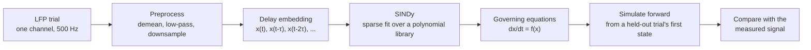
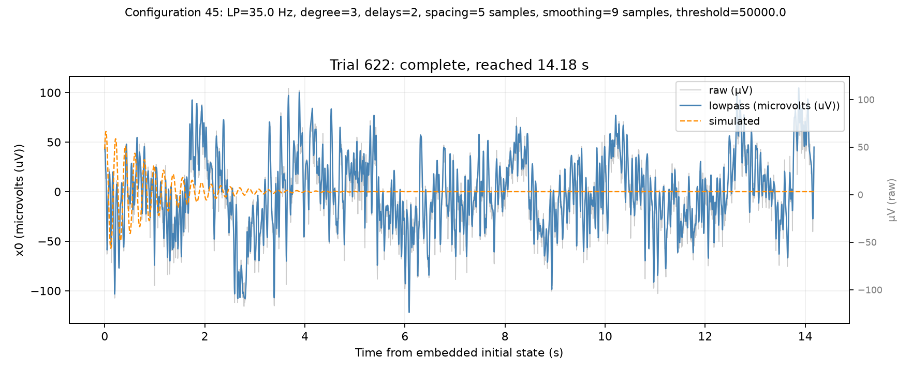
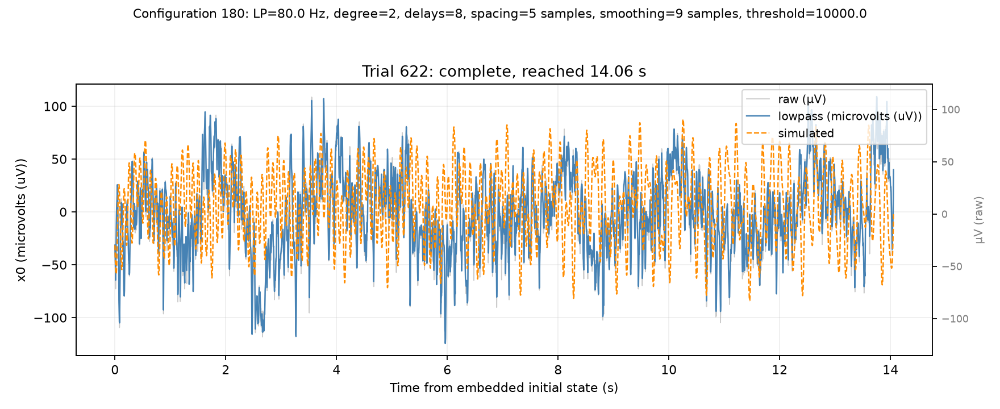
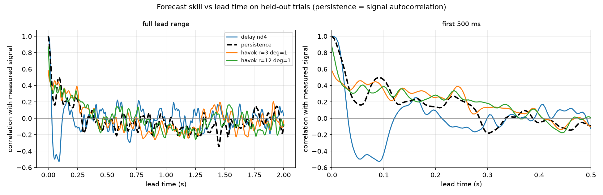

# lfp-symreg

**Can a small set of differential equations describe how a cortical local field
potential evolves over time?**

This repository holds the code for a summer research project at Brown
University's Carney Institute for Brain Science (Desrochers Lab, Carney
Quantitative Scholars Award, 2026). It fits ordinary differential equation
models to local field potentials (LFPs) recorded from macaque lateral prefrontal
cortex, using sparse regression (SINDy) on delay-embedded single-channel
signals, and then tests how well the fitted equations reproduce held-out data.

Presented as a poster: [*Seeking dynamical models of cortical local field
potentials via machine learning*](docs/poster.pdf) (Abkenova, Buyukyazgan,
Conen, Ritt, Desrochers).


## The idea in one picture



Standard LFP analyses (evoked potentials, spectral decomposition) describe the
signal but do not give a model that can be run forward. An explicit equation
could be simulated under conditions that were never recorded. The project asks
how far that goal can be pushed with current equation-discovery tools, and what
the answer depends on.

## What was done

- **Hyperparameter sweeps on an HPC cluster.** About 2,000 SINDy configurations
  varying polynomial degree, sparsity threshold, ridge strength, low-pass
  cutoff, number of delay coordinates, delay spacing and derivative smoothing.
- **Held-out evaluation.** Trials are split 75/25. Every fitted model is
  integrated forward from the first state of each held-out trial with no access
  to later measurements, then compared with the recording.
- **Baselines and alternatives.** HAVOK (Hankel-SVD coordinates), a deep delay
  autoencoder with a SINDy latent space (AE-SINDy), PySR symbolic regression,
  and a persistence baseline for forecast skill.
- **A source-level audit of PySINDy.** [docs/pysindy_internals.md](docs/pysindy_internals.md)
  traces what the library does at each stage and how its defaults affect the
  fitted equations, with a probe script for each claim.

## What was found

SINDy produces plausible dynamical models of the LFP only under restricted
conditions. Recovered models fall into three qualitative types:

1. fixed-frequency, fixed-amplitude oscillators,
2. weakly nonlinear models that keep a stable dominant frequency,
3. unstable models whose trajectories diverge.

Across hyperparameters the dominant rhythm persists while the nonlinear
structure does not. The number of delay coordinates caps how many oscillation
frequencies a model can express, which explains much of the variation between
configurations.

| Two delay coordinates: one frequency, decays | Eight delay coordinates: sustained, multi-frequency |
|---|---|
|  |  |

Grey is the raw recording, blue the low-pass filtered signal, and dashed orange
the free-running simulation from the trial's initial state.

Forecast skill against lead time shows the limit clearly. On held-out trials,
correlation with the measured signal falls to around zero within a few hundred
milliseconds, and no model clearly outperforms the signal's own autocorrelation
(the persistence baseline):



More figures are in [results/figures](results/figures).

## Repository layout

```text
lfp-symreg/
├── load_data/          MATLAB loading, trial selection, preprocessing, synthetic data
├── models/             SINDy, HAVOK, AE-SINDy, PySR wrappers; simulation and metrics
├── scripts/
│   ├── pysindy/        sweeps, merging, simulation, figures
│   │   ├── internals_probes/          probes backing docs/pysindy_internals.md
│   │   └── normalization_validation/
│   ├── aesindy/        autoencoder runs, forecast skill, HAVOK baseline
│   ├── channel_analysis/   signal quality and channel/trial comparisons
│   └── pysr/           PySR sweep
├── slurm/              Slurm job files for the HPC cluster
│   ├── pysindy/
│   └── aesindy/
├── results/figures/    a small curated set of result figures
├── docs/               scientific assumptions, output schema, PySINDy internals
├── requirements.txt
└── requirements-optional.txt
```

`models/` and `load_data/` are the reusable layer; everything in `scripts/` is a
runnable command-line entry point that imports from them.

## Running it

Python 3.12 or newer.

```bash
python -m venv .venv
```

```bash
.venv/bin/pip install -r requirements.txt
```

**Without any data.** The pipeline can be checked end to end on a simulated
Lorenz system, which it should recover:

```bash
.venv/bin/python scripts/pysindy/exploration_sweep.py --source lorenz --degree-list 2 --n-delays-list 1 --delay-list 1 --simulation-horizon 2
```

**With LFP data.** The recordings are not public and are not in this
repository. With access, place the MATLAB file in `raw_data/` (or pass
`--mat-file`):

```bash
.venv/bin/python scripts/pysindy/exploration_sweep.py --source lfp --trial-type fixation --channel 0 --degree-list 1,2 --n-delays-list 2,4,6 --delay-list 1,2,5 --lowpass-list 35,80 --simulation-horizon 2
```

The large sweeps run as Slurm array jobs submitted from the repository root,
for example `sbatch slurm/pysindy/run_raw_grid_array.slurm`, and their parts are
merged with `scripts/pysindy/merge_raw_grid.py`. Generated files go to
`outputs/`, which is not tracked.

PySR and the PyTorch autoencoder need the packages in
`requirements-optional.txt`. The TensorFlow reference implementation of
AE-SINDy uses its own environment, built by `scripts/aesindy/setup_oscar.sh`.

## Documentation

- [docs/poster.pdf](docs/poster.pdf): the poster.
- [docs/scientific_assumptions.md](docs/scientific_assumptions.md): what the
  pipeline does at each step, which choices are provisional, and open questions.
- [docs/output_schema.md](docs/output_schema.md): every column in the result
  tables, with units.
- [docs/pysindy_internals.md](docs/pysindy_internals.md): how PySINDy behaves
  internally and what that means for configuring it.

## Data

Recordings come from macaque lateral prefrontal cortex during a no-report
sequence viewing task (Desrochers Lab). The data belong to the lab and are not
distributed here.

## Acknowledgements

Work by Aida Abkenova with Defne Buyukyazgan, Katherine E. Conen, Jason Ritt
and Theresa M. Desrochers. Supported by a Carney Quantitative Scholars Award from Brown
University's Carney Institute for Brain Science.

Methods used: SINDy (Brunton, Proctor and Kutz, PNAS 2016) via
[PySINDy](https://github.com/dynamicslab/pysindy); HAVOK (Brunton et al., 2017);
deep delay autoencoders (Bakarji et al., arXiv:2201.05136);
[PySR](https://github.com/MilesCranmer/PySR) (Cranmer, 2023).
