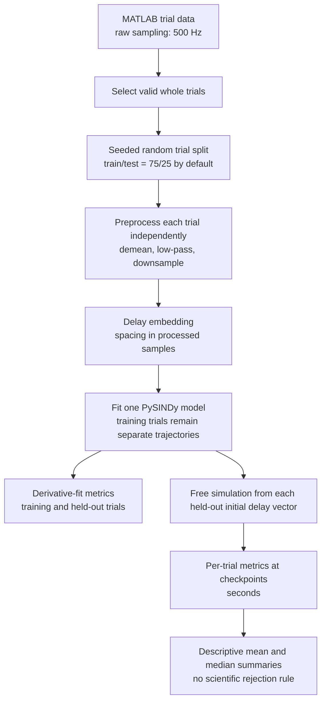

# Scientific Assumptions

This document separates current pipeline behavior from unresolved scientific
decisions. A software default is not evidence that a choice is scientifically
appropriate.

## Pipeline

## Confirmed Behavior

### Trial selection

- Fixation trials satisfy both `is_fixation_trial` and `goodFix`.
- Non-fixation trials satisfy both `is_sequence_trial` and
`goodFix_wholeseq`.
- The active work currently uses fixation trials, but trial selection remains
reusable for non-fixation trials.
- Unequal-length trials remain separate trajectories. They are not padded or
concatenated.
- The full stored fixation trace is used. No timing crop is applied.

### Train/test split

- Whole trials are shuffled with NumPy using the recorded integer seed.
- The default test fraction is `0.25`.
- There is no additional non-contiguous-holdout rule. Random assignment is the
only split requirement.

### Preprocessing

- The project sampling frequency is 500 Hz.
- LFP amplitude values loaded from the MATLAB file are measured in microvolts
  (`uV`).
- Each trial is demeaned with `scipy.signal.detrend(..., type="constant")`.
This removes its DC mean but does not constitute a high-pass filter.
- The optional low-pass is a fourth-order Butterworth filter applied forward
and backward with `sosfiltfilt`, producing zero phase shift.
- Filtering occurs before downsampling.
- The default downsampling factor is 2, producing 250 Hz samples and a
0.004-second sample interval.
- The active sweep applies no software high-pass filter.
- The active default is no amplitude normalization. Demeaning preserves the
original amplitude scale but shifts the trial mean to zero.
- `zscore` remains available only as an explicit CLI choice. It converts each
trial independently to its own standard-deviation units and removes absolute
amplitude comparability between trials.

### Delay embedding

- `n_delays` is the number of state coordinates.
- `delay_samples` is coordinate spacing in processed samples.
- At processed interval `dt`, spacing is `delay_samples * dt` seconds.
- Embedding span is `(n_delays - 1) * delay_samples * dt` seconds.
- Coordinate `x0` is the current LFP sample. Later coordinates are older
samples from the same channel.

### PySINDy fitting

- The current Oscar raw-grid sweep varies polynomial degree, low-pass cutoff,
  number of delay coordinates, delay spacing, and derivative smoothing window.
- STLSQ threshold is fixed at 0.1, PySINDy's current default.
- STLSQ ridge regularization `alpha` is explicitly recorded as 0.05,
  PySINDy's current default. Threshold and alpha are different parameters.
- STLSQ normalizes polynomial-library columns before sparse thresholding and
  rescales final coefficients to the original microvolt coordinates.
- A zero-sample smoothing window uses PySINDy's finite-difference method.
- Five- and nine-sample windows use Savitzky-Golay smoothed finite differences
  with polynomial order 3. At 250 Hz these windows span 20 and 36 ms.

### Current raw-grid stage

- The raw grid contains 216 fits: `3 degrees x 2 low-pass cutoffs x 4 delay
  counts x 3 delay spacings x 3 smoothing windows`.
- Only training trials are fitted. The 25% held-out trials remain reserved for
  later evaluation.
- No simulation or diagnostic metric is calculated during this stage.
- Full-precision coefficient matrices, feature names, readable equations, fit
  status, term count, and runtime are saved.

### Simulation and evaluation

- A simulation begins at the first complete delay vector of a held-out trial.
- The model receives no later measured values during simulation.
- Simulation horizon and evaluation checkpoints are measured in seconds.
- The active numerical solver is SciPy LSODA. It was selected because it can
switch between non-stiff and stiff integration; it is a provisional numerical
choice, not a scientific acceptance criterion.
- The solver uses relative tolerance `1e-7` and absolute tolerance `1e-9`.
- No arbitrary right-hand-side evaluation cutoff is imposed. The number of
  equation evaluations requested by LSODA is recorded for each simulation.
- No amplitude threshold is imposed by the active sweep.
- PSD, KS distance, collapse ratio, correlations, and RMSE are
descriptive outputs. None currently accepts or rejects a model.
- Each held-out trial is recorded separately. Main and checkpoint tables also
report means, medians, and simulation-success fractions.
- Failure of one held-out trajectory does not reject the whole configuration.
It produces `partial_failure` and remains visible in the trial-level table.

## Provisional Implementation Choices

These choices are explicit but not yet scientifically validated:

- LSODA and its numerical tolerances.
- Welch PSD with at most 256 samples per segment.
- Collapse ratio as simulated second-half standard deviation divided by
measured full-window standard deviation.
- Mean and median as descriptive cross-trial summaries.
- STLSQ ridge `alpha=0.05` inherited from PySINDy's default.

## Disabled Until Approved

- Autocorrelation similarity is not part of the initial pipeline because no lag
  duration has been approved.
- Time until divergence is `NaN` unless both its error threshold and persistence
duration are supplied.
- No physiological amplitude rejection threshold is defined.
- No PSD, autocorrelation, distribution, collapse, RMSE, correlation, sparsity,
or eigenvalue threshold is used for rejection or ranking.

## Unresolved Questions

- Was a hardware or earlier preprocessing high-pass filter applied?
- Should amplitude normalization be used, and if so, across what reference set?
- If autocorrelation is reintroduced, which lag is meaningful for the shortest
  evaluated horizon?
- How should practical divergence be defined: error scale and persistence time?
- Should STLSQ threshold or ridge alpha be swept after the baseline run?
- Should LSODA and its tolerances be compared with another integrator?
- Which descriptive summaries should ultimately rank models?
- What failure fraction, if any, should disqualify a fitted equation?
